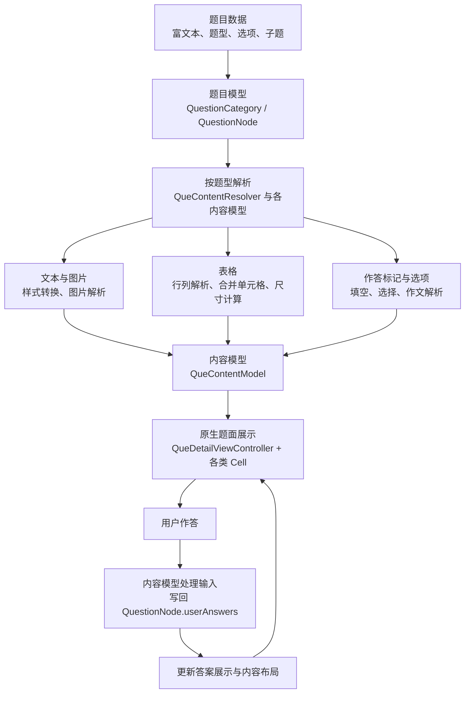

# ExamQuestionType

一个面向英语试题的 iOS 富文本解析与原生作答示例项目。数据源来自富文本内容，客户端解析其中的结构、样式和作答标记，展示对应的题面，并收集用户答案。

## 核心特性

- **富文本内容拆解与模型化**：解析服务器提供的富文本，识别段落、图片、表格及作答标记，生成对应的内容模型，连接题目数据与原生界面。
- **复杂表格解析与排版**：处理 `rowspan`、`colspan` 等合并关系，计算单元格位置和内容尺寸，将 HTML 表格转换为可交互的原生表格。
- **富文本中的嵌入式作答**：将 `<blk>` 标记转换为题干中的可点击空位或作文输入区，让用户直接在题目内容中完成填空、选择和文本输入。
- **多题型组合渲染**：通过题目节点与子题结构组织独立题、阅读理解和完形填空，复用文本、图片、表格和作答组件，按题型生成不同题面。

## 重要组成

- [HTMLDocument](ExamQuestionType/Resovler/HTMLDocument.swift)：封装 libxml2，将 HTML 解析为节点树，通过 `HTMLNode` 提供标签、文本、属性和父子节点的访问接口。
- [QueContentResolver](ExamQuestionType/Resovler/QueContentResolver.swift)：题面解析器，遍历段落、图片、表格与作答标记，生成对应内容模型，并合并相邻的描述文本。
- **模型层**：

  - [QueContentFillBlankModel](ExamQuestionType/Model/QueContentFillBlankModel.swift)：将空位转换为可点击的富文本片段，管理焦点、答案索引、答案回写与结果展示；选择填空模型继承并复用其能力。
  - [TableModel](ExamQuestionType/Model/QueContentTableModel.swift)：解析表格行列及跨行、跨列关系，计算单元格位置和尺寸。

    等模型负责组织文字、图片、表格、填空、作文和选项的展示数据及作答状态。

- **Cell 展示层**：以 [QueContentTableCell](ExamQuestionType/Cell/QueContentTableCell.swift) 为例，使用集合视图展示表格单元格，协调表格内填空交互和内容变化后的高度更新；文字、图片、填空和作文等内容由各自的 Cell 展示，并响应用户交互。

## 模块流程



## 解析是怎么做的

流程：**使用 libxml2 解析 HTML → 获得 HTMLNode 节点树 → 按节点类型生成内容模型 → 由对应 Cell 展示**。

### 使用什么解析 HTML

1. `HTMLDocument` 封装 libxml2 的 `htmlReadMemory`，将 HTML 字符串解析为原生节点树。
2. `HTMLNode` 封装节点，提供标签名、文本、属性和子节点等读取接口。例如，`name` 获取标签名，`text` 获取文本节点内容，`attribute(named:)` 获取属性值，`children` 获取按原文顺序排列的子节点。
3. 普通题面和作文题面由 `QueContentResolver` 从 `body`（不存在时使用根节点）开始递归遍历，根据节点类型和标签名生成对应模型。

例如：

```html
<p>123456<blk></blk>789</p>
```

解析后，`p` 的子节点依次为文本 `123`、`img` 元素、文本 `456`、`blk` 元素、文本 `789`，生成模型时也遵循这一顺序。

### 解析后的节点如何生成模型

- **文字 → `QueContentDescribeModel`**：读取文本节点内容，根据外层 `<b>`、`<u>`、`<i>` 等标签设置字体、下划线、斜体等富文本属性，生成 `NSMutableAttributedString`，通过 `init(attr:)` 创建描述模型。`<p>` 提供段落对齐和换行，`<br>` 提供换行；相邻的描述模型由解析器合并。
- **图片 → `QueContentImgModel`**：读取 `` 的 `src`、`width`、`height`，生成保存地址和尺寸的 `ImgModel`，再创建图片内容模型。
- **表格 → `QueContentTableModel`**：将 `<table>` 节点传入模型，由 `TableModel` 遍历表头、行和单元格，生成 `TableHeadModel`、`TableTrModel`、`TableTdModel`。读取 `rowspan`、`colspan` 计算单元格位置；单元格内部按节点顺序将文字、图片和 `<blk>` 转换为富文本、图片附件和作答片段。
- **作答标记 → 根据题面生成内容**：普通题面的 `<blk>` 转换为 `____`，放入描述模型；作文题面的 `<blk>` 创建 `QueContentEssayModel`，关联题目和连续的答案索引。
- **填空与选择填空 → 对应作答模型**：填空入口先尝试创建表格模型，非表格内容交给 `QueContentFillBlankModel`；选择填空由 `QueContentSelectFillBlankModel` 组织题面空位和对应选项。
- **选择题选项 → `QueContentSelectOptionModel`**：从 `question.options` 字段读取选项数组，创建选项模型。

解析器按内容顺序返回 `[QueContentModel]`，详情页根据各模型的 `cellType` 使用对应的 Cell 展示。

## 题型示例

以下列出各题型的输入内容与展示截图，便于对照解析效果。

### 填空解析
```
<p>        Tu Youyou was awarded with Nobel Prize for Physiology or Medicine in 2015, because she has discovered artemisinin, which（1）<blk mlen=\"3\"  mstyle=\"underline\" ></blk>(use) as a crucial new treatment for malaria to save millions of people.</p><p>        Born in Ningbo, China, she graduated（2）<blk mlen=\"3\"  mstyle=\"underline\" ></blk>Peking University Medical School in 1955. She was among the first researchers（3）<blk mlen=\"3\"  mstyle=\"underline\" ></blk>(choose) for the objective of discovering a new treatment for malaria. At first, she went to Hainan because there was more malaria（4）<blk mlen=\"3\"  mstyle=\"underline\" ></blk>(patient). When she headed the project in 1969, she decided to find traditional（5）<blk mlen=\"3\"  mstyle=\"underline\" ></blk>(botany) treatments for the disease, so her team examined over 2, 000 old medical texts and evaluated 280, 000 plants, from（6）<blk mlen=\"3\"  mstyle=\"underline\" ></blk>they tested 380 distinct ancient Chinese medical treatments.</p>
```
内容解析

并且支持``标签解析，比如这样


### 选择填空解析
```
<p>        It is an honor for me to give this speech as one of the graduating students and welcome you to this special Graduating Ceremony 2020 in Tsinghua University.</p><p>        This is a （1）<blk mlen=\"3\"  mstyle=\"underline\" ></blk>moment. We are stepping up to another period of our lives at a time of great hardship and global （2）<blk mlen=\"3\"  mstyle=\"underline\" ></blk>. Tsinghua keeps in mind its global family, and hopes this ceremony will help （3）<blk mlen=\"3\"  mstyle=\"underline\" ></blk>sad memories, refresh beautiful ones and （4）<blk mlen=\"3\"  mstyle=\"underline\" ></blk>more wonderful memories into our lives.</p>
```
加上选项解析


### 表格填空解析
```
<table border=\"1\"><tbody><tr><td rowspan=\"6\" width=\"62\"><p>Kate</p></td><td width=\"252\"><p>How old is she?</p></td><td width=\"239\"><p>12.</p></td></tr><tr><td width=\"252\"><p>What is her favorite sport?</p></td><td width=\"239\"><p>Swimming.</p></td></tr><tr><td width=\"252\"><p><blk></blk> <blk></blk> has she been doing the sport?</p></td><td width=\"239\"><p>6 years.</p></td></tr><tr><td width=\"252\"><p>Why does she like it?</p></td><td width=\"239\"><p>Because her <blk></blk> <blk></blk> is Zhang Yufei.</p></td></tr><tr><td width=\"252\"><p>What\'s her goal?</p></td><td width=\"239\"><p>To be a <blk></blk> swimmer.</p></td></tr><tr><td width=\"252\"><p>What will she do in the future?</p></td><td width=\"239\"><p>Try <blk></blk> and <blk></blk>.</p></td></tr></tbody></table>
```
内容解析


### 选择解析
```
<p>Celeste Ng\'s latest book, ___ plot is quite new and original, has received a lot of attention.</p>
```
加上选项，解析


### 作文解析
```
<p>请你以你校学生会的名义写一则关于成立英语阅读俱乐部（English book club）的英语通知，内容包括：</p><p>1.阅读在生活中的重要性；</p><p>2.成立英语阅读俱乐部的目的；</p><p>3.欢迎报名参加及提供建议。</p><p>注意：</p><p>1.词数100左右；</p><p>2.可以适当增加细节，以使行文连贯；</p><table border=\"1\"><tbody><tr><td rowspan=\"6\" width=\"62\"><p>Kate</p></td><td width=\"252\"><p>How old is she?</p></td><td width=\"239\"><p>12.</p></td></tr><tr><td width=\"252\"><p>What is her favorite sport?</p></td><td width=\"239\"><p>Swimming.</p></td></tr><tr><td width=\"252\"><p>How long has she been doing the sport?</p></td><td width=\"239\"><p><u>       </u> years.</p></td></tr><tr><td width=\"252\"><p>Why does she like it?</p></td><td width=\"239\"><p>Because her <u>   </u><u>   </u> is Zhang Yufei.</p></td></tr><tr><td width=\"252\"><p>What\'s her goal?</p></td><td width=\"239\"><p>To be a <u>        </u> swimmer.</p></td></tr><tr><td width=\"252\"><p>What will she do in the future?</p></td><td width=\"239\"><p>Try <u>       </u> and <u>       </u>.</p></td></tr></tbody></table><p></p><p>转述开头：Kate is twelve years old.</p><p><blk mlen=\"3\"  mstyle=\"underline\" ></blk></p>
```
内容解析


## 补充说明

### 1. TFHpple 是什么库

TFHpple 是一个用于解析 HTML、XML 的 Objective-C 库，底层基于 `libxml2`，支持通过 XPath 查找节点。它将 HTML 内容转换为可访问的节点，方便读取标签名、属性、内部内容和子节点，本身不负责网页渲染。

### 2. 表格如何做到跨行、跨列

核心是用数组 `barrierArr` 记录每一列的占位情况，数值表示该列还被跨行单元格占用多少行。

1. 按行遍历单元格，检查当前单元格需要占据的列范围是否存在阻碍。
2. 如果存在阻碍，就向后移动候选列位置，继续检查，直到找到可以放下当前单元格的位置。
3. 确定位置后，将它覆盖的各列在 `barrierArr` 中设为 `rowspan`，包含当前行；跨列则决定需要更新多少列，并将候选位置推进 `colspan` 列。
4. 检查障碍时只读取计数，每行处理结束后统一将正数计数减一；计数归零后，该列在下一行恢复可用。

这样，后续单元格会避开已有的合并区域，新的跨行、跨列单元格又会补充占位记录，从而确定各单元格的位置。
