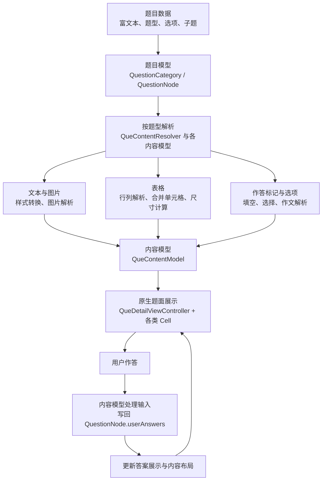

# ExamQuestionType

一个面向英语试题的 iOS 富文本解析与原生作答示例项目。数据源来自富文本内容，客户端解析其中的结构、样式和作答标记，展示对应的题面，并收集用户答案。

## 核心特性

- **富文本内容拆解与模型化**：解析服务器提供的富文本，识别段落、图片、表格及作答标记，生成对应的内容模型，连接题目数据与原生界面。
- **复杂表格解析与排版**：处理 `rowspan`、`colspan` 等合并关系，计算单元格位置和内容尺寸，将 HTML 表格转换为可交互的原生表格。
- **富文本中的嵌入式作答**：将 `<blk>` 标记转换为题干中的可点击空位或作文输入区，让用户直接在题目内容中完成填空、选择和文本输入。
- **多题型组合渲染**：通过题目节点与子题结构组织独立题、阅读理解和完形填空，复用文本、图片、表格和作答组件，按题型生成不同题面。

## 重要组成

- [QuestionCategory](ExamQuestionType/QuestionCategory.swift)：题型分类模型，保存分类名称、说明与题目集合，并提供本地示例数据。
- [QuestionNode](ExamQuestionType/QuestionNode.swift)：题目节点，保存题干、题型、选项、答案及子题，并按题型调用解析器生成内容模型。
- [QueContentResolver](ExamQuestionType/Model/QueContentModel.swift)：题面解析器，拆解富文本中的段落、图片、表格与作答标记，生成对应内容模型，并合并相邻的描述文本。
- [QueContentFillBlankModel](ExamQuestionType/Model/QueContentFillBlankModel.swift)：填空内容模型，将空位转换为可点击的富文本片段，管理焦点、答案索引、答案回写与结果展示；选择填空模型继承并复用其能力。
- [EQTableModel](ExamQuestionType/Model/QueContentTableModel.swift)：表格结构与布局模型，解析行列及跨行、跨列关系，计算单元格位置和尺寸，供表格组件展示。
- [QueContentTableCell](ExamQuestionType/Cell/QueContentTableCell.swift)：原生表格组件，使用集合视图展示单元格，协调表格内填空交互和内容变化后的高度更新。
- [QueDetailViewController](ExamQuestionType/QueDetailViewController.swift)：题目详情页，组织内容 Cell、切换题目、展示选项面板，并处理键盘避让与界面刷新。

## 模块流程



## 题型示例

以下保留各题型的输入内容与展示截图，便于对照解析效果。

### 填空解析
```
<p>        Tu Youyou was awarded with Nobel Prize for Physiology or Medicine in 2015, because she has discovered artemisinin, which（1）<blk mlen=\"3\"  mstyle=\"underline\" ></blk>(use) as a crucial new treatment for malaria to save millions of people.</p><p>        Born in Ningbo, China, she graduated（2）<blk mlen=\"3\"  mstyle=\"underline\" ></blk>Peking University Medical School in 1955. She was among the first researchers（3）<blk mlen=\"3\"  mstyle=\"underline\" ></blk>(choose) for the objective of discovering a new treatment for malaria. At first, she went to Hainan because there was more malaria（4）<blk mlen=\"3\"  mstyle=\"underline\" ></blk>(patient). When she headed the project in 1969, she decided to find traditional（5）<blk mlen=\"3\"  mstyle=\"underline\" ></blk>(botany) treatments for the disease, so her team examined over 2, 000 old medical texts and evaluated 280, 000 plants, from（6）<blk mlen=\"3\"  mstyle=\"underline\" ></blk>they tested 380 distinct ancient Chinese medical treatments.</p>
```
内容解析

并且支持``标签解析，比如这样


### 选择填空解析
```
<p>        It is an honor for me to give this speech as one of the graduating students and welcome you to this special Graduating Ceremony 2020 in Tsinghua University.</p><p>        This is a （1）<blk mlen=\"3\"  mstyle=\"underline\" ></blk>moment. We are stepping up to another period of our lives at a time of great hardship and global （2）<blk mlen=\"3\"  mstyle=\"underline\" ></blk>. Tsinghua keeps in mind its global family, and hopes this ceremony will help （3）<blk mlen=\"3\"  mstyle=\"underline\" ></blk>sad memories, refresh beautiful ones and （4）<blk mlen=\"3\"  mstyle=\"underline\" ></blk>more wonderful memories into our lives.</p>
```
加上选项解析


### 表格填空解析
```
<table border=\"1\"><tbody><tr><td rowspan=\"6\" width=\"62\"><p>Kate</p></td><td width=\"252\"><p>How old is she?</p></td><td width=\"239\"><p>12.</p></td></tr><tr><td width=\"252\"><p>What is her favorite sport?</p></td><td width=\"239\"><p>Swimming.</p></td></tr><tr><td width=\"252\"><p><blk></blk> <blk></blk> has she been doing the sport?</p></td><td width=\"239\"><p>6 years.</p></td></tr><tr><td width=\"252\"><p>Why does she like it?</p></td><td width=\"239\"><p>Because her <blk></blk> <blk></blk> is Zhang Yufei.</p></td></tr><tr><td width=\"252\"><p>What\'s her goal?</p></td><td width=\"239\"><p>To be a <blk></blk> swimmer.</p></td></tr><tr><td width=\"252\"><p>What will she do in the future?</p></td><td width=\"239\"><p>Try <blk></blk> and <blk></blk>.</p></td></tr></tbody></table>
```
内容解析


### 选择解析
```
<p>Celeste Ng\'s latest book, ___ plot is quite new and original, has received a lot of attention.</p>
```
加上选项，解析


### 作文解析
```
<p>请你以你校学生会的名义写一则关于成立英语阅读俱乐部（English book club）的英语通知，内容包括：</p><p>1.阅读在生活中的重要性；</p><p>2.成立英语阅读俱乐部的目的；</p><p>3.欢迎报名参加及提供建议。</p><p>注意：</p><p>1.词数100左右；</p><p>2.可以适当增加细节，以使行文连贯；</p><table border=\"1\"><tbody><tr><td rowspan=\"6\" width=\"62\"><p>Kate</p></td><td width=\"252\"><p>How old is she?</p></td><td width=\"239\"><p>12.</p></td></tr><tr><td width=\"252\"><p>What is her favorite sport?</p></td><td width=\"239\"><p>Swimming.</p></td></tr><tr><td width=\"252\"><p>How long has she been doing the sport?</p></td><td width=\"239\"><p><u>       </u> years.</p></td></tr><tr><td width=\"252\"><p>Why does she like it?</p></td><td width=\"239\"><p>Because her <u>   </u><u>   </u> is Zhang Yufei.</p></td></tr><tr><td width=\"252\"><p>What\'s her goal?</p></td><td width=\"239\"><p>To be a <u>        </u> swimmer.</p></td></tr><tr><td width=\"252\"><p>What will she do in the future?</p></td><td width=\"239\"><p>Try <u>       </u> and <u>       </u>.</p></td></tr></tbody></table><p></p><p>转述开头：Kate is twelve years old.</p><p><blk mlen=\"3\"  mstyle=\"underline\" ></blk></p>
```
内容解析

