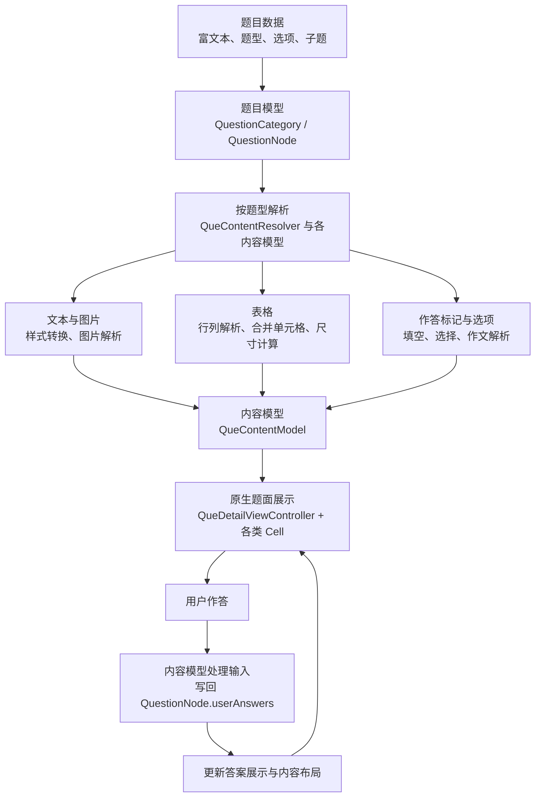

# ExamQuestionType

一个面向英语试题的 iOS 富文本解析与原生作答示例项目。数据源来自富文本内容，客户端解析其中的结构、样式和作答标记，展示对应的题面，并收集用户答案。

## 核心特性

- **富文本内容拆解与模型化**：解析服务器提供的富文本，识别段落、图片、表格及作答标记，生成对应的内容模型，连接题目数据与原生界面。
- **复杂表格解析与排版**：处理 `rowspan`、`colspan` 等合并关系，计算单元格位置和内容尺寸，将 HTML 表格转换为可交互的原生表格。
- **富文本中的嵌入式作答**：将 `<blk>` 标记转换为题干中的可点击空位或作文输入区，让用户直接在题目内容中完成填空、选择和文本输入。
- **多题型组合渲染**：通过题目节点与子题结构组织独立题、阅读理解和完形填空，复用文本、图片、表格和作答组件，按题型生成不同题面。

## 重要组成

- [QuestionCategory](ExamQuestionType/QuestionCategory.swift)：题型分类模型，保存分类名称、说明与题目集合，并提供本地示例数据。
- [QuestionNode](ExamQuestionType/QuestionNode.swift)：题目节点，保存题干、题型、选项、答案及子题，并按题型调用解析器生成内容模型。
- [QueContentResolver](ExamQuestionType/Model/QueContentResolver.swift)：题面解析器，拆解富文本中的段落、图片、表格与作答标记，生成对应内容模型，并合并相邻的描述文本。
- [QueContentFillBlankModel](ExamQuestionType/Model/QueContentFillBlankModel.swift)：填空内容模型，将空位转换为可点击的富文本片段，管理焦点、答案索引、答案回写与结果展示；选择填空模型继承并复用其能力。
- [EQTableModel](ExamQuestionType/Model/QueContentTableModel.swift)：表格结构与布局模型，解析行列及跨行、跨列关系，计算单元格位置和尺寸，供表格组件展示。
- [QueContentTableCell](ExamQuestionType/Cell/QueContentTableCell.swift)：原生表格组件，使用集合视图展示单元格，协调表格内填空交互和内容变化后的高度更新。
- [QueDetailViewController](ExamQuestionType/QueDetailViewController.swift)：题目详情页，组织内容 Cell、切换题目、展示选项面板，并处理键盘避让与界面刷新。

## 模块流程



## 解析是怎么做的

解析分为旧版正则拆解和新版节点遍历两套实现。当前普通题面、选择题面的题干、作文题面，以及表格结构和单元格内容均已迁移到新版；非表格填空题面、选择填空题面仍沿用旧版。

### 旧版：正则拆解标签

流程：**正则匹配 → 递归拆解标签 → 解析内容与属性 → 生成模型**。

1. 根据题型选择正则表达式，使用 `.*?` 非贪婪匹配识别内容块，并保留标签之间的普通文字及原文顺序。
2. 取出段落等标签的内部 HTML 继续递归拆解，将不同标签交给对应模型。
3. 模型通过 TFHpple 读取节点与属性，或通过富文本扩展将行内标签转换为文字样式，生成可供 Cell 展示的内容。

#### 正则表达式与标签映射

##### 普通题面和选择题面

旧版 `normalResolver` 使用：

```regex
(<table.*?</table>)|()|(<blk.*?</blk>)|(<p.*?</p>)
```

- `<table>` → [表格模型 QueContentTableModel](#table-model)。
- `` → [图片模型 QueContentImgModel](#image-model)。
- `<p>` → 递归拆解内部 HTML，文字生成[描述模型 QueContentDescribeModel](#describe-model)。
- `<blk>` → 转为 `____` 占位，归入[描述模型](#describe-model)。
- 选择题的 `options` 字段 → [选项模型 QueContentSelectOptionModel](#option-model)。

##### 填空题面

```regex
(<blk.*?</blk>)|()|(<u.*?</u>)|(<p.*?</p>)
```

- `<blk>`、`<u>`、`<p>` 和普通文字 → [填空模型 QueContentFillBlankModel](#fill-blank-model)，组合为带空位的富文本。
- `` → [图片属性解析 ImgModel](#image-model)，加载后由填空模型插入富文本附件。

填空入口优先尝试[表格模型](#table-model)；表格结构由 TFHpple 解析，单元格内部使用：

```regex
(<blk.*?</blk>)|(<blk.*?/>)|(<p.*?</p>)
```

- `<blk>`、自闭合 `<blk .../>`、`<p>` 和普通文字 → [表格单元格模型 EQTableTdModel](#table-model)。

##### 选择填空题面

```regex
(<blk.*?</blk>)|()|(<u.*?</u>)|(<p.*?</p>)
```

- `<blk>`、`<u>`、`<p>` 和普通文字 → [选择填空模型 QueContentSelectFillBlankModel](#select-fill-blank-model)，继承填空模型的富文本解析。
- `` → [图片属性解析 ImgModel](#image-model)，加载后插入富文本附件。
- 选项字段 → [选择填空模型](#select-fill-blank-model)，按空位索引关联选项。

##### 作文题面

旧版 `essayResolver` 使用：

```regex
(<table.*?</table>)|()|(<blk.*?</blk>)|(<p.*?</p>)
```

- `<table>` → [表格模型 QueContentTableModel](#table-model)。
- `` → [图片模型 QueContentImgModel](#image-model)。
- `<p>` → 递归拆解内部 HTML，文字生成[描述模型 QueContentDescribeModel](#describe-model)。
- `<blk>` → [作文模型 QueContentEssayModel](#essay-option-models)，展示作文输入区。

#### 模型解析网页元素

以下说明各模型接收拆分后的 HTML 或题目字段时，如何提取内容并生成展示数据。

<a id="describe-model"></a>

##### 描述模型 `QueContentDescribeModel`

这里描述 `init(html:)` 入口；新版直接使用 `init(attr:)` 接收已转换的富文本。

1. 通过 TFHpple 的 XPath `//p` 查找段落节点。
2. 取出各段内容，转换成 `NSMutableAttributedString`，设置段落对齐等属性，按顺序添加换行并拼接；没有段落节点时，直接处理传入内容。
3. 使用 `<u.*?</u>`、`<i.*?</i>` 等正则识别行内标签，去掉标签并对内部文字设置对应属性，例如下划线、粗体和斜体；同时处理换行标签和 HTML 实体。
4. 输出最终的 `handleContentAttr`，交给 `QueContentDescribeCell` 展示。

<a id="image-model"></a>

##### 图片模型 `QueContentImgModel`

1. 通过 TFHpple 的 XPath `//img` 查找图片节点。
2. 读取各节点的 `src` 属性并转换为 URL，跳过缺少地址或无法转换为 URL 的节点。
3. 读取可选的 `width`、`height` 属性，转换为数值，生成 `ImgModel`。
4. `ImgModel.load(html:)` 返回图片模型数组；`QueContentImgModel(html:)` 取第一个保存为 `imageModel`。

<a id="table-model"></a>

##### 表格模型 `QueContentTableModel` / `EQTableModel`

以下为旧版节点读取与内容拆解方式；当前表格结构和单元格内容均已改用 `HTMLNode`，见新版说明。

1. 通过 TFHpple 的 XPath `//table` 查找表格，取第一个表格节点进行解析。
2. 遍历表头、表体和 `<tr>` 节点，再遍历各行的 `<td>`，生成行模型和单元格模型。
3. 读取 `<td>` 的 `rowspan`、`colspan` 属性，转换为跨行、跨列数量；未提供时默认为 1。
4. 取出单元格内部内容，用正则拆解 `<p>`、`<blk>` 和自闭合 `<blk .../>`，将普通文字转换为富文本、空位转换为带索引的作答片段，再拼接为单元格的 `resultAttributed`。
5. 汇总行列数量与合并关系，确定单元格的逻辑位置，输出 `tableModel`。

<a id="fill-blank-model"></a>

##### 填空模型 `QueContentFillBlankModel`

1. 用正则拆解 `<p>`、`<u>`、`` 和 `<blk>`，将标签之间的普通文字转换为 `NSMutableAttributedString`。
2. 取出 `<p>`、`<u>` 的内部内容递归解析，分别补充换行和下划线属性。
3. 通过图片模型读取 `` 的地址和尺寸，加载后转换为 `NSTextAttachment`，替换原位置的占位片段。
4. 按 `<blk>` 的出现顺序分配空位索引，根据已有答案生成答案文字或空白占位，添加 `blank:索引` 链接与下划线属性。
5. 将内容片段存入 `allAttrArr`，空位片段另外记录到 `fillBlankAttrArr`，最后拼接成 `resultAttributed`。

<a id="select-fill-blank-model"></a>

##### 选择填空模型 `QueContentSelectFillBlankModel`

1. 继承填空模型，复用文字、段落、下划线、图片和空位的解析，生成 `resultAttributed`。
2. 普通模式读取本题的 `options`，按答案数量为各空位关联公共选项；组合模式按子题顺序读取各自的 `options`。
3. 生成与空位索引对应的选项数组，保存为 `options`。这些选项来自题目字段，不通过 HTML 标签解析。

<a id="essay-option-models"></a>

##### 作文模型 `QueContentEssayModel`

1. `essayResolver` 拆解题面，将文字、图片、表格交给各自模型；识别到 `<blk>` 时创建 `QueContentEssayModel`。
2. 将题目和对应答案索引 `index` 传入模型，建立作答位置与 `question.userAnswers` 的关联。
3. 模型不继续解析 `<blk>` 内部 HTML，而是根据索引提供已有答案文本，供作文输入区使用。

<a id="option-model"></a>

##### 选项模型 `QueContentSelectOptionModel`

1. 读取 `question.options`，没有选项或数组为空时不创建模型。
2. 保存选项数组与所属题目，供选项单元展示。模型不解析 HTML 标签。

### 新版：HTMLDocument 节点遍历

流程：**libxml2 建立节点树 → 递归遍历节点 → 读取属性并转换内容 → 生成模型**。

当前入口为 `normalResolver(question:html:isResult:)` 和 `essayResolver(question:html:essayOffset:isResult:)`，两者共用 `QueContentResolver.resolveHTML`。

#### 建立节点树并按顺序遍历

1. `HTMLDocument` 调用 libxml2 的 `htmlReadMemory` 解析 HTML，通过 `HTMLNode` 保留原生节点、属性和父子关系。
2. 从 `body`（不存在时使用根节点）开始，按 `children` 的顺序递归遍历，同时处理文本节点和元素节点，不再通过正则查找内容块。
3. 遍历时携带行内样式和段落对齐，遇到图片、表格或作答标记时生成对应模型；表格整体交给现有表格模型，不重复展开内部节点。
4. 题号单独生成描述内容，再与题干模型合并，避免题号被解析器补成独立段落。作文答案索引从 `essayOffset` 开始，在整次遍历中连续递增。

例如：

```html
<p>123456<blk></blk>789</p>
```

按 `123 → img → 456 → blk → 789` 的顺序处理，保留文字和元素的交错关系。

#### 节点与模型映射

| 节点 | 处理方式与输出 |
| --- | --- |
| 文本节点 | 直接构建 `NSMutableAttributedString`，通过 `QueContentDescribeModel(attr:)` 保存，保留空白，避免重新解析已解码的文字。 |
| `<p>` | 读取 `align`，递归遍历子节点，结束时追加换行。 |
| `<b>`、`<strong>`、`<i>`、`<em>`、`<u>`、`<sup>`、`<sub>` | 递归传递样式上下文，为内部文字直接设置相应富文本属性；空 `<u>` 不生成人工占位。 |
| `<br>` | 生成换行文字。 |
| `` | 直接读取节点的 `src`、`width`、`height`，生成 `ImgModel` 和 `QueContentImgModel`。 |
| `<table>` | 直接将节点传给 `QueContentTableModel(question:node:isResult:)`，通过 `HTMLNode` 遍历表头、表体、行和单元格，并读取合并属性；单元格内部也通过节点遍历生成文字、图片和空位片段。 |
| 普通题面的 `<blk>` | 生成 `____` 占位，归入描述模型。 |
| 作文题面的 `<blk>` | 生成 `QueContentEssayModel`，保存题目与连续的答案索引。 |
| `<head>`、`<script>`、`<style>`、注释节点 | 跳过，不生成展示内容。 |
| 其他容器或行内节点 | 按顺序遍历其子节点。 |

表格的 HTML 字符串入口仍保留：内部通过 `HTMLDocument` 找到首个 table 节点，再复用节点初始化入口。表格及单元格直接复用节点树，不再序列化后重新解析。`EQTableTdModel` 按子节点顺序生成富文本；作答和结果模式共用遍历逻辑，遇到 `<blk>` 时分别调用对应的空位生成方法，并递增全局空位索引。图片地址与尺寸直接从节点读取，加载后替换原位置的附件占位。

选择题的选项仍从独立的 `question.options` 字段创建 `QueContentSelectOptionModel`。新版改变的是题面拆解与文字转换方式，最终仍由原有内容模型和 Cell 展示。

## 题型示例

以下保留各题型的输入内容与展示截图，便于对照解析效果。

### 填空解析
```
<p>        Tu Youyou was awarded with Nobel Prize for Physiology or Medicine in 2015, because she has discovered artemisinin, which（1）<blk mlen=\"3\"  mstyle=\"underline\" ></blk>(use) as a crucial new treatment for malaria to save millions of people.</p><p>        Born in Ningbo, China, she graduated（2）<blk mlen=\"3\"  mstyle=\"underline\" ></blk>Peking University Medical School in 1955. She was among the first researchers（3）<blk mlen=\"3\"  mstyle=\"underline\" ></blk>(choose) for the objective of discovering a new treatment for malaria. At first, she went to Hainan because there was more malaria（4）<blk mlen=\"3\"  mstyle=\"underline\" ></blk>(patient). When she headed the project in 1969, she decided to find traditional（5）<blk mlen=\"3\"  mstyle=\"underline\" ></blk>(botany) treatments for the disease, so her team examined over 2, 000 old medical texts and evaluated 280, 000 plants, from（6）<blk mlen=\"3\"  mstyle=\"underline\" ></blk>they tested 380 distinct ancient Chinese medical treatments.</p>
```
内容解析

并且支持``标签解析，比如这样


### 选择填空解析
```
<p>        It is an honor for me to give this speech as one of the graduating students and welcome you to this special Graduating Ceremony 2020 in Tsinghua University.</p><p>        This is a （1）<blk mlen=\"3\"  mstyle=\"underline\" ></blk>moment. We are stepping up to another period of our lives at a time of great hardship and global （2）<blk mlen=\"3\"  mstyle=\"underline\" ></blk>. Tsinghua keeps in mind its global family, and hopes this ceremony will help （3）<blk mlen=\"3\"  mstyle=\"underline\" ></blk>sad memories, refresh beautiful ones and （4）<blk mlen=\"3\"  mstyle=\"underline\" ></blk>more wonderful memories into our lives.</p>
```
加上选项解析


### 表格填空解析
```
<table border=\"1\"><tbody><tr><td rowspan=\"6\" width=\"62\"><p>Kate</p></td><td width=\"252\"><p>How old is she?</p></td><td width=\"239\"><p>12.</p></td></tr><tr><td width=\"252\"><p>What is her favorite sport?</p></td><td width=\"239\"><p>Swimming.</p></td></tr><tr><td width=\"252\"><p><blk></blk> <blk></blk> has she been doing the sport?</p></td><td width=\"239\"><p>6 years.</p></td></tr><tr><td width=\"252\"><p>Why does she like it?</p></td><td width=\"239\"><p>Because her <blk></blk> <blk></blk> is Zhang Yufei.</p></td></tr><tr><td width=\"252\"><p>What\'s her goal?</p></td><td width=\"239\"><p>To be a <blk></blk> swimmer.</p></td></tr><tr><td width=\"252\"><p>What will she do in the future?</p></td><td width=\"239\"><p>Try <blk></blk> and <blk></blk>.</p></td></tr></tbody></table>
```
内容解析


### 选择解析
```
<p>Celeste Ng\'s latest book, ___ plot is quite new and original, has received a lot of attention.</p>
```
加上选项，解析


### 作文解析
```
<p>请你以你校学生会的名义写一则关于成立英语阅读俱乐部（English book club）的英语通知，内容包括：</p><p>1.阅读在生活中的重要性；</p><p>2.成立英语阅读俱乐部的目的；</p><p>3.欢迎报名参加及提供建议。</p><p>注意：</p><p>1.词数100左右；</p><p>2.可以适当增加细节，以使行文连贯；</p><table border=\"1\"><tbody><tr><td rowspan=\"6\" width=\"62\"><p>Kate</p></td><td width=\"252\"><p>How old is she?</p></td><td width=\"239\"><p>12.</p></td></tr><tr><td width=\"252\"><p>What is her favorite sport?</p></td><td width=\"239\"><p>Swimming.</p></td></tr><tr><td width=\"252\"><p>How long has she been doing the sport?</p></td><td width=\"239\"><p><u>       </u> years.</p></td></tr><tr><td width=\"252\"><p>Why does she like it?</p></td><td width=\"239\"><p>Because her <u>   </u><u>   </u> is Zhang Yufei.</p></td></tr><tr><td width=\"252\"><p>What\'s her goal?</p></td><td width=\"239\"><p>To be a <u>        </u> swimmer.</p></td></tr><tr><td width=\"252\"><p>What will she do in the future?</p></td><td width=\"239\"><p>Try <u>       </u> and <u>       </u>.</p></td></tr></tbody></table><p></p><p>转述开头：Kate is twelve years old.</p><p><blk mlen=\"3\"  mstyle=\"underline\" ></blk></p>
```
内容解析


## 补充说明

### 1. TFHpple 是什么库

TFHpple 是一个用于解析 HTML、XML 的 Objective-C 库，底层基于 `libxml2`，支持通过 XPath 查找节点。它将 HTML 内容转换为可访问的节点，方便读取标签名、属性、内部内容和子节点，本身不负责网页渲染。

项目中的用途包括：

- 通过 `//p` 查找段落，读取 `align` 等属性。
- 通过 `//img` 查找图片，读取 `src`、`width`、`height`。
- 旧版通过 `//table` 查找表格并读取合并属性；当前表格结构已改用 `HTMLNode`。

例如，解析图片地址：

```swift
let parser = TFHpple(data: htmlData, isXML: false)
let images = parser?.search(withXPathQuery: "//img") as? [TFHppleElement]

for image in images ?? [] {
    let src = image.object(forKey: "src")
}
```

### 2. 表格如何做到跨行、跨列

核心是用数组 `barrierArr` 记录每一列的占位情况，数值表示该列还被跨行单元格占用多少行。

1. 按行遍历单元格，检查当前单元格需要占据的列范围是否存在阻碍。
2. 如果存在阻碍，就向后移动候选列位置，继续检查，直到找到可以放下当前单元格的位置。
3. 确定位置后，如果单元格跨行，就将它覆盖的各列在 `barrierArr` 中设为 `rowspan - 1`；跨列则决定需要更新多少列。
4. 遍历后续行时，遇到已有阻碍会递减对应计数；计数归零后，该列恢复可用。

这样，后续单元格会避开已有的合并区域，新的跨行、跨列单元格又会补充占位记录，从而确定各单元格的位置。
